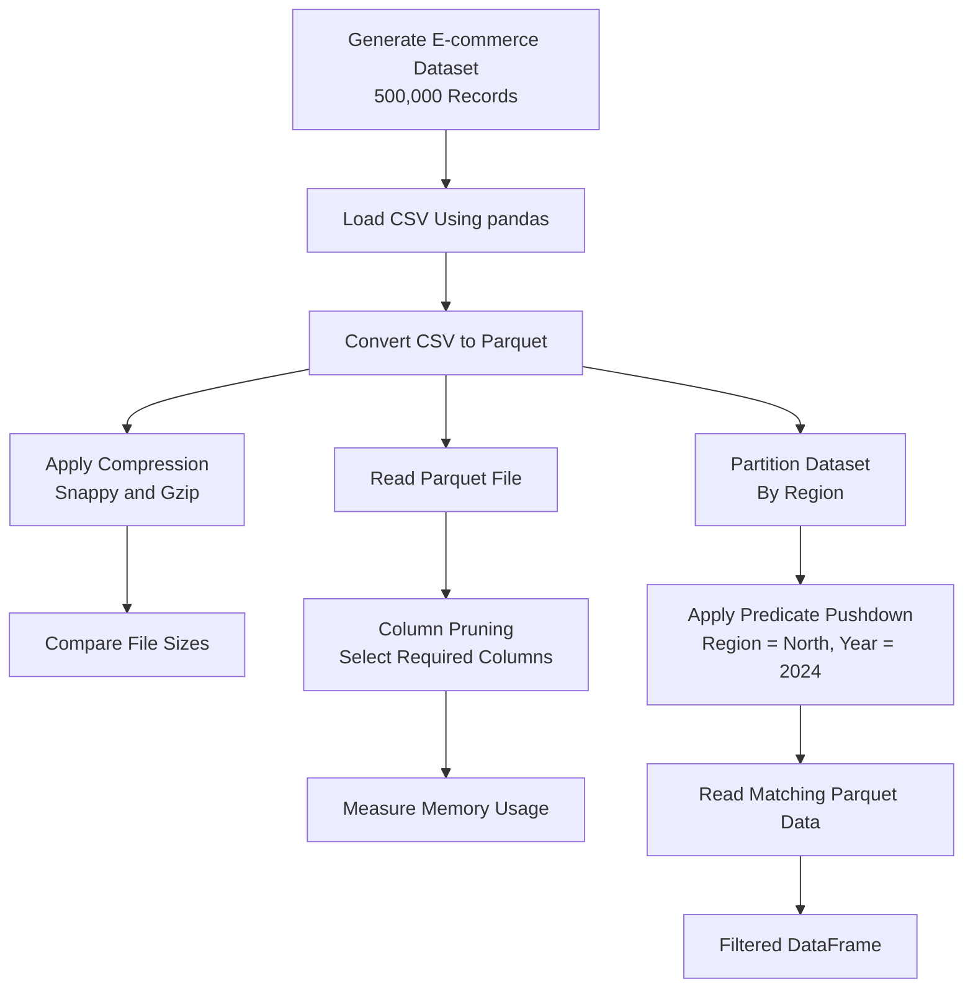

# Apache Parquet

---

## 1. Project Overview

This project demonstrates how to use **Apache Parquet with Python, pandas, and PyArrow** for efficient data storage and analytical processing.

The project uses a generated e-commerce dataset containing 500,000 records. It explores different Parquet compression codecs, column pruning, partitioning, and predicate pushdown.

---

### Objectives

- Load a tabular dataset using pandas.
- Convert CSV data into Apache Parquet format.
- Compare Snappy and Gzip compression.
- Read selected columns from Parquet files.
- Compare memory usage before and after column pruning.
- Create a partitioned Parquet dataset.
- Demonstrate predicate pushdown using PyArrow.
- Understand Parquet's internal storage architecture.

---

## 2. Technology Stack

| Technology       | Version / Usage        |
| ---------------- | ---------------------- |
| Python           | 3.14.3                 |
| pandas           | 3.1.1                  |
| PyArrow          | 26.0.1                 |
| NumPy            | 2.5.4                  |
| pip              | 25.3                   |
| IDE              | Visual Studio Code     |
| Operating System | Windows 11             |
| Data Format      | CSV and Apache Parquet |

---

## 3. Project Structure

```text
apache-parquet-assignment/
│
├── .venv/
│
├── data/
│   ├── raw/
│   │   └── ecommerce_data.csv
│   │
│   ├── parquet/
│   │   ├── ecommerce_snappy.parquet
│   │   └── ecommerce_gzip.parquet
│   │
│   └── partitioned/
│       └── ecommerce_by_region/
│           ├── region=East/
│           ├── region=North/
│           ├── region=South/
│           └── region=West/
│
├── scripts/
│   ├── generate_dataset.py
│   ├── compression_comparison.py
│   ├── column_pruning.py
│   └── partitioning_pushdown.py
│
├── .gitignore
├── requirements.txt
└── README.md
```

---

### Important Files

| File                        | Description                                                  |
| --------------------------- | ------------------------------------------------------------ |
| `generate_dataset.py`       | Generates the 500,000-record e-commerce dataset.             |
| `compression_comparison.py` | Compares Snappy and Gzip compression.                        |
| `column_pruning.py`         | Demonstrates selected-column reading and memory reduction.   |
| `partitioning_pushdown.py`  | Creates partitioned Parquet data and demonstrates filtering. |
| `ecommerce_data.csv`        | Original raw dataset.                                        |
| `ecommerce_snappy.parquet`  | Parquet file using Snappy compression.                       |
| `ecommerce_gzip.parquet`    | Parquet file using Gzip compression.                         |
| `ecommerce_by_region/`      | Partitioned Parquet dataset.                                 |

---

## 4. Environment Setup

### Step 1: Create the Project Directory

```cmd
mkdir D:\apache-parquet-assignment
cd /d D:\apache-parquet-assignment
```

---

### Step 2: Create a Virtual Environment

```cmd
python -m venv .venv
```

Activate the environment:

```cmd
.venv\Scripts\activate
```

---

### Step 3: Install Required Libraries

```cmd
python -m pip install --upgrade pip
python -m pip install pandas
python -m pip install pyarrow
```

---

### Step 4: Verify Installation

```cmd
python --version
python -m pip --version
```

Verify pandas and PyArrow:

```cmd
python -c "import pandas as pd; import pyarrow as pa; print('Pandas:', pd.__version__); print('PyArrow:', pa.__version__)"
```

Installed versions:

- Python: 3.14.3
- pandas: 3.1.1
- PyArrow: 26.0.1

---

### Step 5: Create Project Folders

```cmd
mkdir data
mkdir data\raw
mkdir data\parquet
mkdir data\partitioned
mkdir scripts
```

---

### Step 6: Create requirements.txt

```text
pandas==3.1.1
pyarrow==26.0.1
numpy==2.5.4
```

Install dependencies using:

```cmd
python -m pip install -r requirements.txt
```

---

## 5. Implementation Steps

### Step 1: Generate the E-commerce Dataset

Created `scripts/generate_dataset.py` using pandas and NumPy.

The script generates 500,000 records containing 10 columns.

**Dataset columns:**

| Column      | Description             |
| ----------- | ----------------------- |
| order_id    | Unique order identifier |
| customer_id | Customer identifier     |
| product     | Product name            |
| category    | Product category        |
| region      | Geographical region     |
| order_date  | Order date              |
| year        | Order year              |
| quantity    | Purchased quantity      |
| unit_price  | Price per unit          |
| sales       | Total sales amount      |

The dataset contains four regions:

- North
- South
- East
- West

The generated records cover the years 2022 to 2025.

**Execute:**

```cmd
python scripts\generate_dataset.py
```

**Result:**

```text
Dataset generated successfully!
Total records: 500000
Total columns: 10
Dataset shape: (500000, 10)

CSV file saved at: data\raw\ecommerce_data.csv
```

---

### Step 2: Convert CSV into Parquet Using Different Compression Codecs

Created `scripts/compression_comparison.py`.

The script reads the CSV dataset and generates two Parquet files using different compression codecs.

**Snappy compression:**

```python
df.to_parquet(
    snappy_file,
    engine="pyarrow",
    compression="snappy",
    index=False
)
```

**Gzip compression:**

```python
df.to_parquet(
    gzip_file,
    engine="pyarrow",
    compression="gzip",
    index=False
)
```

**Execute:**

```cmd
python scripts\compression_comparison.py
```

**Actual results:**

| Compression Codec | File Size |
| ----------------- | --------: |
| Snappy            |  10.87 MB |
| Gzip              |   7.91 MB |

Gzip produced a file approximately 27.22% smaller than Snappy for this dataset.

**Observation:**

- Snappy generally prioritizes fast compression and decompression.
- Gzip generally provides a higher compression ratio.
- The best codec depends on the workload and performance requirements.

---

### Step 3: Demonstrate Column Pruning

Created `scripts/column_pruning.py`.

Column pruning means reading only the required columns instead of loading the entire dataset.

The full dataset contains 10 columns. For the experiment, only these three columns were selected:

- `order_id`
- `region`
- `sales`

**Read all columns:**

```python
df_full = pd.read_parquet(
    parquet_file,
    engine="pyarrow"
)
```

**Read selected columns:**

```python
df_selected = pd.read_parquet(
    parquet_file,
    engine="pyarrow",
    columns=["order_id", "region", "sales"]
)
```

**Execute:**

```cmd
python scripts\column_pruning.py
```

**Actual results:**

| Dataset          | Columns | Memory Usage |
| ---------------- | ------: | -----------: |
| Full Dataset     |      10 |     53.13 MB |
| Selected Dataset |       3 |     13.59 MB |

**Memory reduction: 74.42%**

**Observation:**

Parquet's columnar storage allows the reader to retrieve only the requested columns. This reduces unnecessary data reading and the memory required by the resulting DataFrame.

The memory figures above represent pandas DataFrame memory usage after loading, not the physical Parquet file size.

---

### Step 4: Create a Partitioned Parquet Dataset

Created `scripts/partitioning_pushdown.py`.

The dataset was partitioned using the categorical column `region`.

The following folders were generated:

```text
ecommerce_by_region/
│
├── region=East/
├── region=North/
├── region=South/
└── region=West/
```

The partitioned dataset was created using:

```python
df.to_parquet(
    output_dir,
    engine="pyarrow",
    compression="snappy",
    partition_cols=["region"],
    index=False
)
```

**Observation:**

Each region has its own Parquet data file. This organization makes it possible to avoid scanning unrelated region partitions when querying a particular region.

---

### Step 5: Demonstrate Predicate Pushdown

Predicate pushdown means applying filter conditions at the data-reading layer rather than loading all records into memory and filtering afterward.

For this experiment, the following conditions were used:

- Region = North
- Year = 2024

The partitioned dataset was opened using PyArrow:

```python
dataset = ds.dataset(
    output_dir,
    format="parquet",
    partitioning="hive"
)
```

**Define filter conditions:**

```python
filter_condition = (
    (ds.field("region") == "North") &
    (ds.field("year") == 2024)
)
```

**Read filtered records:**

```python
table = dataset.to_table(
    columns=["order_id", "region", "year", "sales"],
    filter=filter_condition
)
```

**Execute:**

```cmd
python scripts\partitioning_pushdown.py
```

**Actual results:**

| Parameter          | Result  |
| ------------------ | ------- |
| Original records   | 500,000 |
| Selected region    | North   |
| Selected year      | 2024    |
| Matching fragments | 1       |
| Filtered records   | 31,229  |
| Selected columns   | 4       |

**Observation:**

PyArrow identified only one matching Parquet fragment under the North partition.

Partition pruning avoided scanning the other three region partitions. The additional year filter was applied during the Parquet scan, allowing available row-group statistics to help skip irrelevant data.

Note: The experiment confirms partition pruning through the matching-fragment result. It does not independently measure the number of row groups skipped.

---

## 6. End-to-End Architecture Flowchart

The following flowchart represents the complete Apache Parquet workflow implemented in this project.



### Flowchart Explanation

1. **Dataset Generation:** Generate 500,000 e-commerce records using Python.
2. **CSV Loading:** Load the generated dataset into a pandas DataFrame.
3. **Parquet Conversion:** Convert the CSV data into Parquet format.
4. **Compression:** Apply Snappy and Gzip compression and compare storage sizes.
5. **Column Pruning:** Read only selected columns from the Parquet file.
6. **Memory Analysis:** Compare the memory usage of the full and selected DataFrames.
7. **Partitioning:** Divide the dataset into region-specific Parquet folders.
8. **Predicate Pushdown:** Apply region and year filters while reading the partitioned dataset.
9. **Filtered Output:** Retrieve only the matching records and selected columns.

---

## 7. Summary – Apache Parquet Storage Architecture

Apache Parquet is a columnar storage format designed for efficient analytical workloads. Unlike traditional row-based formats, where values belonging to one record are stored together, Parquet organizes data by columns. Its physical storage layout consists of Row Groups, Column Chunks, and Pages.

A Row Group is a horizontal partition of a dataset containing a subset of rows. Within each Row Group, every column is stored separately in its own Column Chunk. A Column Chunk contains the values for one column across that Row Group. Each Column Chunk is further divided into Pages, which are the basic units of encoding and compression.

This organization improves analytical query performance because applications can read only the required columns rather than scanning entire records. For example, a query requesting only sales and region does not need to read customer IDs or product details.

Parquet also stores metadata and statistics, such as minimum and maximum values, which can help query engines skip irrelevant Row Groups through predicate pushdown. Compression and encoding techniques further reduce storage requirements and data transfer.

As a result, Parquet is particularly effective for data warehouses, business intelligence, reporting, and large-scale analytical processing.

---

## 8. Key Concepts Learned

| Concept            | Explanation                                                  |
| ------------------ | ------------------------------------------------------------ |
| Apache Parquet     | Columnar file format for analytical workloads.               |
| Snappy             | Compression codec prioritizing speed.                        |
| Gzip               | Compression codec often providing higher compression ratios. |
| Column Pruning     | Reading only required columns.                               |
| Partitioning       | Dividing data into separate directory-based partitions.      |
| Predicate Pushdown | Applying filters during data scanning.                       |
| Row Group          | Horizontal subset of rows in a Parquet file.                 |
| Column Chunk       | Data for one column within a Row Group.                      |
| Page               | Basic unit of Parquet column data storage and encoding.      |

---

## 9. Final Outcome

The Apache Parquet hands-on assignment was successfully implemented.

The project demonstrates:

- Loading and processing a 500,000-record dataset using pandas.
- Converting CSV data into Parquet format.
- Comparing Snappy and Gzip compression.
- Achieving a 27.22% smaller file using Gzip in this experiment.
- Reading selected columns and reducing DataFrame memory usage by 74.42%.
- Creating a partitioned Parquet dataset using the region column.
- Applying predicate pushdown to filter North region records for 2024.
- Understanding Parquet's internal storage architecture.

**Final Result: Successful implementation of Apache Parquet compression, column pruning, partitioning, and predicate pushdown using Python, pandas, and PyArrow.**
